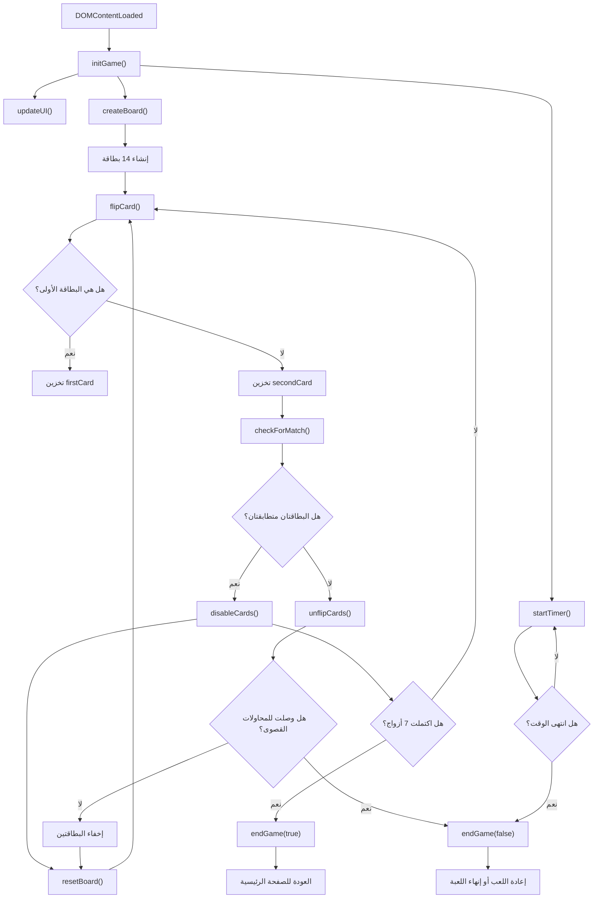

# 🃏 Card Matching Game – لعبة تطابق البطاقات

## 📖 نبذة عن المشروع

لعبة تطابق البطاقات (Card Matching Game) هي لعبة ذاكرة تفاعلية تعتمد على التركيز وسرعة الملاحظة، حيث يتعين على اللاعب اكتشاف جميع أزواج البطاقات المتطابقة خلال وقت محدد، مع الالتزام بعدد معين من المحاولات الخاطئة.

تتكون اللعبة من 14 بطاقة موزعة على 7 أزواج متطابقة، ويتم ترتيب البطاقات عشوائياً عند بدء اللعبة أو إعادة تشغيلها.

تدعم اللعبة ثلاثة مستويات للصعوبة، ويختلف كل مستوى في الوقت المتاح وعدد المحاولات الخاطئة المسموح بها.

---

## 🛠️ التقنيات المستخدمة

- **HTML5:** إنشاء هيكل صفحات اللعبة وعناصر الواجهة.
- **CSS3:** تنسيق البطاقات والواجهة وإضافة تأثيرات الحركة.
- **JavaScript (Vanilla JS):** برمجة منطق اللعبة وإدارة الأحداث.
- **DOM Manipulation:** إنشاء عناصر البطاقات والتعامل مع عناصر HTML.
- **Local Storage:** قراءة مستوى الصعوبة المخزن في المتصفح.
- **JavaScript Timer Functions:** إدارة الوقت والتأخير باستخدام `setInterval()` و`setTimeout()`.

---

## ⚙️ إعدادات اللعبة

يتم جلب مستوى الصعوبة من `localStorage` باستخدام المفتاح `gameDifficulty`.

```javascript
const difficulty = localStorage.getItem("gameDifficulty") || "easy";
```

في حال عدم وجود قيمة مخزنة، يتم اعتماد المستوى السهل تلقائياً.

### مستويات الصعوبة

| المستوى   |    الوقت | المحاولات الخاطئة |
| --------- | -------: | ----------------: |
| Easy 🟢   | 50 ثانية |                10 |
| Medium 🟡 | 35 ثانية |                 8 |
| Hard 🔴   | 25 ثانية |                 6 |

إعدادات المستويات داخل الكود:

```javascript
const settings = {
  easy: {
    time: 50,
    maxWrong: 10,
  },
  medium: {
    time: 35,
    maxWrong: 8,
  },
  hard: {
    time: 25,
    maxWrong: 6,
  },
};
```

يتم تحديد إعدادات المستوى الحالي من خلال:

```javascript
const currentSettings = settings[difficulty] || settings.easy;
```

---

# 🧠 شرح المتغيرات المستخدمة

قبل شرح الدوال، من المهم فهم المتغيرات التي تتحكم في حالة اللعبة.

| المتغير            | الوظيفة                                               |
| ------------------ | ----------------------------------------------------- |
| `difficulty`       | مستوى الصعوبة المخزن في المتصفح.                      |
| `settings`         | كائن يحتوي على إعدادات مستويات الصعوبة.               |
| `currentSettings`  | إعدادات مستوى الصعوبة الحالي.                         |
| `timeLeft`         | الوقت المتبقي للاعب بالثواني.                         |
| `wrongAttempts`    | عدد المحاولات الخاطئة التي قام بها اللاعب.            |
| `maxWrongAttempts` | الحد الأقصى للمحاولات الخاطئة.                        |
| `timerInterval`    | معرّف المؤقت المستخدم لإيقافه لاحقاً.                 |
| `isGamePlaying`    | يحدد ما إذا كانت اللعبة لا تزال قيد التشغيل.          |
| `hasFlippedCard`   | يحدد ما إذا كان اللاعب قد قلب البطاقة الأولى.         |
| `lockBoard`        | يمنع الضغط على البطاقات مؤقتاً أثناء معالجة الاختيار. |
| `firstCard`        | يخزن مرجع البطاقة الأولى التي اختارها اللاعب.         |
| `secondCard`       | يخزن مرجع البطاقة الثانية.                            |
| `matchedPairs`     | عدد الأزواج التي تم العثور عليها بنجاح.               |
| `totalPairs`       | العدد الإجمالي للأزواج، ويساوي 7.                     |
| `cardSymbols`      | مصفوفة الرموز المستخدمة لإنشاء البطاقات.              |

---

# 📌 شرح جميع الدوال في JavaScript

يحتوي الكود على 11 دالة رئيسية، بالإضافة إلى دوال رد النداء (Callback Functions) المستخدمة مع الأحداث والمؤقتات.

## 1. دالة initGame()

**الوظيفة:** تهيئة اللعبة وإعادة ضبط جميع المتغيرات إلى قيمها الافتراضية، ثم إنشاء لوحة البطاقات وتشغيل المؤقت.

```javascript
function initGame() {
  timeLeft = currentSettings.time;
  wrongAttempts = 0;
  matchedPairs = 0;
  isGamePlaying = true;
  hasFlippedCard = false;
  lockBoard = false;
  firstCard = null;
  secondCard = null;

  updateUI();
  createBoard();
  startTimer();
}
```

**شرح آلية العمل:**

1. إعادة الوقت إلى القيمة المحددة في مستوى الصعوبة.
2. تصفير عدد المحاولات الخاطئة.
3. تصفير عدد الأزواج المتطابقة.
4. إعادة حالة اللعبة إلى وضع التشغيل.
5. إعادة السماح بقلب البطاقات.
6. إلغاء حالة قفل لوحة اللعب.
7. حذف مراجع البطاقات المختارة سابقاً.
8. استدعاء `updateUI()` لتحديث بيانات الواجهة.
9. استدعاء `createBoard()` لإنشاء بطاقات جديدة.
10. استدعاء `startTimer()` لتشغيل المؤقت.

**متى يتم استدعاؤها؟**

- عند فتح صفحة اللعبة لأول مرة.
- عند الضغط على زر إعادة اللعب.
- عند الضغط على زر إعادة اللعب داخل نافذة النتيجة.

---

## 2. دالة createBoard()

**الوظيفة:** إنشاء بطاقات اللعبة وإضافتها إلى لوحة اللعب مع ترتيبها عشوائياً.

```javascript
function createBoard() {
  memoryGameContainer.innerHTML = "";

  const gameCards = [...cardSymbols, ...cardSymbols];

  gameCards.sort(() => Math.random() - 0.5);

  gameCards.forEach((symbol) => {
    const card = document.createElement("div");
    card.classList.add("card");
    card.dataset.symbol = symbol;

    card.innerHTML = `
      <div class="card-face card-front"></div>
      <div class="card-face card-back">${symbol}</div>
    `;

    card.addEventListener("click", flipCard);
    memoryGameContainer.appendChild(card);
  });
}
```

**شرح آلية العمل:**

1. استخدام `innerHTML = ""` لحذف البطاقات القديمة.
2. استخدام Spread Operator لمضاعفة مصفوفة الرموز وإنشاء 14 بطاقة.
3. استخدام `sort()` مع `Math.random()` لخلط ترتيب البطاقات.
4. استخدام `forEach()` للمرور على جميع الرموز.
5. إنشاء عنصر HTML جديد باستخدام `document.createElement()`.
6. إضافة الصنف `card` إلى العنصر.
7. تخزين رمز البطاقة داخل `dataset.symbol`.
8. إنشاء واجهة البطاقة الأمامية والخلفية.
9. إضافة مستمع حدث `click` لاستدعاء `flipCard()`.
10. إضافة البطاقة إلى حاوية اللعبة باستخدام `appendChild()`.

**النتيجة:** إنشاء 14 بطاقة تحتوي على 7 أزواج متطابقة بترتيب عشوائي.

---

## 3. دالة flipCard()

**الوظيفة:** التعامل مع عملية قلب البطاقة عند ضغط اللاعب عليها.

```javascript
function flipCard() {
  if (!isGamePlaying) return;
  if (lockBoard) return;
  if (this === firstCard) return;

  this.classList.add("flip");

  if (!hasFlippedCard) {
    hasFlippedCard = true;
    firstCard = this;
    return;
  }

  secondCard = this;
  checkForMatch();
}
```

**شرح آلية العمل:**

1. التحقق من أن اللعبة لا تزال قيد التشغيل.
2. منع الضغط إذا كانت لوحة اللعب مقفلة.
3. منع اختيار البطاقة نفسها مرتين.
4. إضافة الصنف `flip` لإظهار الوجه الخلفي للبطاقة.
5. التحقق مما إذا كانت هذه أول بطاقة يتم اختيارها.
6. إذا كانت البطاقة الأولى، يتم تخزينها داخل `firstCard`.
7. إذا كانت البطاقة الثانية، يتم تخزينها داخل `secondCard`.
8. استدعاء `checkForMatch()` للتحقق من تطابق البطاقتين.

**معلومة برمجية:**

يتم استخدام الكلمة المفتاحية `this` للإشارة إلى عنصر البطاقة الذي تم الضغط عليه.

---

## 4. دالة checkForMatch()

**الوظيفة:** مقارنة رمز البطاقة الأولى مع رمز البطاقة الثانية لتحديد ما إذا كانتا متطابقتين.

```javascript
function checkForMatch() {
  const isMatch = firstCard.dataset.symbol === secondCard.dataset.symbol;

  if (isMatch) {
    disableCards();
  } else {
    unflipCards();
  }
}
```

**شرح آلية العمل:**

1. قراءة رمز البطاقة الأولى من `dataset.symbol`.
2. قراءة رمز البطاقة الثانية.
3. المقارنة بين الرمزين باستخدام معامل المساواة الصارمة `===`.
4. إذا كان الرمزان متطابقين، يتم استدعاء `disableCards()`.
5. إذا كانا مختلفين، يتم استدعاء `unflipCards()`.

**النتيجة:** تحديد الإجراء المناسب بناءً على نتيجة المقارنة.

---

## 5. دالة disableCards()

**الوظيفة:** تثبيت البطاقتين عند العثور على تطابق صحيح ومنع اللاعب من الضغط عليهما مرة أخرى.

```javascript
function disableCards() {
  firstCard.removeEventListener("click", flipCard);
  secondCard.removeEventListener("click", flipCard);

  matchedPairs++;
  resetBoard();

  if (matchedPairs === totalPairs) {
    endGame(true);
  }
}
```

**شرح آلية العمل:**

1. إزالة مستمع حدث الضغط من البطاقة الأولى.
2. إزالة مستمع حدث الضغط من البطاقة الثانية.
3. زيادة عدد الأزواج المتطابقة بمقدار واحد.
4. استدعاء `resetBoard()` لإعادة ضبط حالة اختيار البطاقات.
5. مقارنة عدد الأزواج المتطابقة بالعدد الإجمالي للأزواج.
6. إذا وصل العدد إلى 7، يتم استدعاء `endGame(true)` لإعلان الفوز.

**النتيجة:** الاحتفاظ بالبطاقات المتطابقة مكشوفة ومنع إعادة اختيارها.

---

## 6. دالة unflipCards()

**الوظيفة:** التعامل مع البطاقات غير المتطابقة واحتساب المحاولة الخاطئة.

```javascript
function unflipCards() {
  lockBoard = true;
  wrongAttempts++;
  wrongAttemptsDisplay.textContent = wrongAttempts;

  if (wrongAttempts >= maxWrongAttempts) {
    setTimeout(() => {
      endGame(false);
    }, 500);
    return;
  }

  setTimeout(() => {
    firstCard.classList.remove("flip");
    secondCard.classList.remove("flip");
    resetBoard();
  }, 800);
}
```

**شرح آلية العمل:**

1. تغيير `lockBoard` إلى `true` لمنع الضغط على بطاقات أخرى.
2. زيادة عدد المحاولات الخاطئة بمقدار واحد.
3. تحديث عدد المحاولات في واجهة المستخدم.
4. التحقق مما إذا وصل اللاعب إلى الحد الأقصى للمحاولات.
5. إذا تجاوز الحد المسموح، يتم استدعاء `endGame(false)` بعد 500 مللي ثانية.
6. إذا لم يصل إلى الحد الأقصى، يتم الانتظار لمدة 800 مللي ثانية.
7. إزالة الصنف `flip` من البطاقتين لإخفائهما.
8. استدعاء `resetBoard()` للسماح بمحاولة جديدة.

**ملاحظة:** يتم احتساب المحاولة الخاطئة عند اختيار بطاقتين غير متطابقتين، وليس عند الضغط على بطاقة واحدة.

---

## 7. دالة resetBoard()

**الوظيفة:** إعادة ضبط حالة اختيار البطاقات بعد انتهاء عملية المطابقة.

```javascript
function resetBoard() {
  [hasFlippedCard, lockBoard] = [false, false];
  [firstCard, secondCard] = [null, null];
}
```

**شرح آلية العمل:**

1. إعادة `hasFlippedCard` إلى `false` للسماح باختيار بطاقة أولى جديدة.
2. إعادة `lockBoard` إلى `false` لفتح لوحة اللعب.
3. تعيين `firstCard` إلى `null`.
4. تعيين `secondCard` إلى `null`.

تستخدم الدالة أسلوب **Destructuring Assignment** لإعادة تعيين عدة متغيرات في تعليمة واحدة.

**متى يتم استدعاؤها؟**

- بعد نجاح المطابقة.
- بعد إخفاء بطاقتين غير متطابقتين.

---

## 8. دالة startTimer()

**الوظيفة:** تشغيل المؤقت التنازلي والتحقق من انتهاء الوقت المسموح به.

```javascript
function startTimer() {
  clearInterval(timerInterval);

  timerInterval = setInterval(() => {
    if (!isGamePlaying) return;

    timeLeft--;
    updateUI();

    if (timeLeft <= 0) {
      clearInterval(timerInterval);
      endGame(false);
    }
  }, 1000);
}
```

**شرح آلية العمل:**

1. استخدام `clearInterval()` لإيقاف أي مؤقت سابق.
2. استخدام `setInterval()` لتنفيذ عملية كل 1000 مللي ثانية.
3. التحقق من أن اللعبة لا تزال قيد التشغيل.
4. إنقاص الوقت المتبقي بمقدار ثانية واحدة.
5. استدعاء `updateUI()` لتحديث الوقت المعروض.
6. التحقق مما إذا وصل الوقت إلى صفر.
7. عند انتهاء الوقت، يتم إيقاف المؤقت.
8. استدعاء `endGame(false)` لإنهاء اللعبة بالخسارة.

**معلومة برمجية:**

- `setInterval()` تنفذ الكود بشكل متكرر خلال فترة زمنية محددة.
- `clearInterval()` توقف تنفيذ المؤقت.

---

## 9. دالة updateUI()

**الوظيفة:** تحديث عناصر واجهة المستخدم وعرض الوقت والمحاولات الخاطئة.

```javascript
function updateUI() {
  wrongAttemptsDisplay.textContent = wrongAttempts;

  let minutes = Math.floor(timeLeft / 60);
  let seconds = timeLeft % 60;

  timerDisplay.textContent = `${minutes.toString().padStart(2, "0")}:${seconds.toString().padStart(2, "0")}`;
}
```

**شرح آلية العمل:**

1. تحديث عدد المحاولات الخاطئة في الواجهة.
2. حساب عدد الدقائق باستخدام `Math.floor()`.
3. حساب عدد الثواني المتبقية باستخدام معامل باقي القسمة `%`.
4. تحويل الدقائق والثواني إلى نصوص.
5. استخدام `padStart(2, "0")` لإضافة صفر إلى بداية الرقم إذا كان مكوناً من خانة واحدة.
6. عرض الوقت بالتنسيق `دقيقة:ثانية`.

**مثال:**

| الوقت بالثواني | العرض |
| -------------: | :---: |
|             50 | 00:50 |
|             35 | 00:35 |
|              9 | 00:09 |
|             65 | 01:05 |

---

## 10. دالة endGame(isWin)

**الوظيفة:** إنهاء اللعبة سواء بالفوز أو الخسارة وعرض نافذة النتيجة المناسبة.

```javascript
function endGame(isWin) {
  isGamePlaying = false;
  clearInterval(timerInterval);

  if (isWin) {
    modalTitle.textContent = "تهانينا! 🎉";
    modalMessage.textContent = "لقد فزت وأتممت مطابقة جميع الكروت بنجاح.";

    overlay.classList.add("active");

    setTimeout(() => {
      window.location.href = "Card-Match-Main.html";
    }, 2500);
  } else {
    modalTitle.textContent = "انتهت اللعبة ❌";
    modalMessage.textContent =
      "للأسف نفد الوقت أو تجاوزت عدد المحاولات الفاشلة المسموحة.";

    overlay.classList.add("active");
  }
}
```

**المعاملات (Parameters):**

| المعامل | النوع   | الوظيفة                                       |
| ------- | ------- | --------------------------------------------- |
| `isWin` | Boolean | يحدد ما إذا كانت نتيجة اللعبة فوزاً أو خسارة. |

**شرح آلية العمل:**

1. تغيير حالة اللعبة إلى متوقفة.
2. إيقاف المؤقت.
3. التحقق من قيمة `isWin`.
4. إذا كانت `true`:
   - عرض عنوان التهنئة.
   - عرض رسالة الفوز.
   - إظهار نافذة النتيجة.
   - الانتقال تلقائياً إلى الصفحة الرئيسية بعد 2500 مللي ثانية.
5. إذا كانت `false`:
   - عرض عنوان انتهاء اللعبة.
   - عرض رسالة توضح سبب الخسارة.
   - إظهار نافذة النتيجة.

**ملاحظة:** تستخدم الدالة `setTimeout()` لتنفيذ الانتقال بعد فترة زمنية محددة، ولا يتم الانتقال تلقائياً عند الخسارة.

---

## 11. دوال الأحداث (Event Listener Callbacks)

بالإضافة إلى الدوال الرئيسية، يحتوي الكود على ثلاث دوال رد نداء يتم تنفيذها عند الضغط على أزرار التحكم.

### أ. حدث زر إعادة اللعب restartBtn

```javascript
if (restartBtn) {
  restartBtn.addEventListener("click", () => {
    overlay.classList.remove("active");
    initGame();
  });
}
```

**الوظيفة:**

- التحقق من وجود زر إعادة اللعب.
- الاستماع إلى حدث الضغط عليه.
- إخفاء نافذة النتيجة باستخدام `classList.remove()`.
- استدعاء `initGame()` لإعادة تشغيل اللعبة.

### ب. حدث زر إعادة اللعب داخل نافذة النتيجة modalRestartBtn

```javascript
if (modalRestartBtn) {
  modalRestartBtn.addEventListener("click", () => {
    overlay.classList.remove("active");
    initGame();
  });
}
```

**الوظيفة:**

- التحقق من وجود زر إعادة اللعب داخل النافذة.
- الاستماع إلى حدث الضغط عليه.
- إخفاء نافذة النتيجة.
- إعادة تهيئة اللعبة والبدء من جديد.

### ج. حدث زر إنهاء اللعبة endBtn

```javascript
if (endBtn) {
  endBtn.addEventListener("click", () => {
    window.location.href = "Card-Match-Main.html";
  });
}
```

**الوظيفة:**

- التحقق من وجود زر إنهاء اللعبة.
- الاستماع إلى حدث الضغط عليه.
- الانتقال مباشرة إلى الصفحة الرئيسية للمشروع.

---

# 🔄 تسلسل عمل الدوال

يوضح المخطط التالي العلاقة بين الدوال وكيفية انتقال التنفيذ بينها أثناء اللعب.



---

# 🖥️ عناصر HTML المطلوبة

يعتمد ملف JavaScript على وجود العناصر التالية في صفحة HTML:

| المعرّف (ID)        | الوظيفة                      |
| ------------------- | ---------------------------- |
| `memory-game`       | الحاوية الرئيسية للبطاقات.   |
| `timer`             | عرض الوقت المتبقي.           |
| `wrong-attempts`    | عرض عدد المحاولات الخاطئة.   |
| `restart-btn`       | زر إعادة تشغيل اللعبة.       |
| `end-btn`           | زر إنهاء اللعبة.             |
| `overlay`           | طبقة نافذة النتيجة.          |
| `modal-restart-btn` | زر إعادة اللعب داخل النافذة. |
| `modal-title`       | عنوان نافذة النتيجة.         |
| `modal-message`     | رسالة نتيجة اللعبة.          |

### أصناف CSS المستخدمة

| Class        | الوظيفة                            |
| ------------ | ---------------------------------- |
| `card`       | تنسيق البطاقة.                     |
| `card-face`  | تنسيق وجهي البطاقة.                |
| `card-front` | الوجه الأمامي للبطاقة.             |
| `card-back`  | الوجه الخلفي الذي يحتوي على الرمز. |
| `flip`       | تنفيذ تأثير قلب البطاقة.           |
| `active`     | إظهار نافذة النتيجة.               |

---

# 🚀 طريقة تشغيل المشروع

1. تحميل ملفات المشروع.
2. التأكد من وجود ملفات HTML وCSS وJavaScript.
3. فتح المشروع باستخدام Visual Studio Code.
4. تشغيل الصفحة الرئيسية:

```text
Card-Match-Main.html
```

5. اختيار مستوى الصعوبة.
6. بدء اللعبة والاستمتاع بالتحدي!

يفضل استخدام إضافة **Live Server** لتشغيل المشروع محلياً أثناء التطوير.

---

# 🧩 مفاهيم JavaScript التي يطبقها المشروع

يساعد المشروع على تطبيق مجموعة من المفاهيم الأساسية والمتوسطة في JavaScript:

- التعامل مع الأحداث باستخدام `addEventListener()`.
- التعامل مع عناصر DOM باستخدام `getElementById()` و`createElement()`.
- استخدام المصفوفات ونسخ عناصرها باستخدام Spread Operator.
- استخدام الدوال الشرطية `if / else`.
- استخدام الحلقات التكرارية `forEach()`.
- استخدام الكائنات `Objects` لتخزين إعدادات الصعوبة.
- استخدام `localStorage` لاسترجاع البيانات.
- استخدام `setInterval()` و`setTimeout()` لإدارة الوقت.
- استخدام `classList` للتحكم في أصناف CSS.
- استخدام `dataset` لتخزين بيانات البطاقات.
- استخدام `Destructuring Assignment`.
- استخدام الدوال المجهولة (Arrow Functions).
- استخدام المتغيرات المنطقية (Boolean) للتحكم في حالة اللعبة.

---

# 💡 تحسينات مستقبلية مقترحة

- إضافة نظام نقاط يعتمد على الوقت وعدد المحاولات.
- حفظ أعلى نتيجة باستخدام `localStorage`.
- إضافة مؤثرات صوتية عند التطابق والخطأ.
- إضافة مستويات صعوبة جديدة.
- إضافة إمكانية اختيار عدد البطاقات.
- إضافة إحصائيات للألعاب السابقة.
- تحسين خوارزمية خلط البطاقات باستخدام Fisher-Yates Shuffle.
- إضافة تصميم متجاوب لجميع أحجام الشاشات.

---

## 👨‍💻 الخاتمة

تم تطوير لعبة تطابق البطاقات بهدف تطبيق مفاهيم JavaScript عملياً، خصوصاً التعامل مع DOM، وإدارة الأحداث، والمصفوفات، والدوال، والمؤقتات، والتخزين المحلي.

المشروع مثال عملي على كيفية تحويل المفاهيم البرمجية إلى تطبيق تفاعلي يجمع بين المنطق البرمجي وتجربة المستخدم.

**🧠 اختبر ذاكرتك، طابق البطاقات، وحاول الفوز قبل انتهاء الوقت!**
